# Proyecto 1: Firmware Controlador de Banda Transportadora

Programación II, Ingeniería Electrónica, UTN. III Cuatrimestre 2026.

Firmware para la IdeaBoard (ESP32) que controla un motorreductor DC con PWM por hardware y atiende un paro de emergencia por interrupción, mediante una máquina de estados orientada a eventos.

## Hardware
- IdeaBoard de CRCibernetica (ESP32)
- Motor DC DG01D con el driver L9110S integrado (IO12 e IO14)
- Microinterruptor de paro de emergencia entre IO33 y GND (INPUT_PULLUP)
- Alimentación: fuente de barril de 5V/3A, jumper en SELECT-Vin

## Entorno
- PlatformIO, placa esp32dev, framework Arduino
- CPU fija en 160 MHz (board_build.f_cpu)

## Estado del proyecto
- [x] Fase 1: entorno y control de versiones
- [x] Fase 2: capa de abstracción de hardware (PWM)
- [x] Fase 3: ISR y depuración por ciclos
- [x] Fase 4: FSM orientada a eventos
- [x] Marco teórico (documentacion/marco_teorico.md)

## Máquina de estados (FSM)

```mermaid
flowchart LR
    INI(( )) --> IDLE((IDLE))
    IDLE -->|"TIMEOUT 3 s / motor adelante"| RUNNING((RUNNING))
    RUNNING -->|"BTN_PRESS / freno dinámico"| FAULT((FAULT))
    FAULT -->|"BTN_PRESS / coast"| IDLE

    IDLE -->|"NONE, BTN_PRESS"| IDLE
    RUNNING -->|"NONE, TIMEOUT"| RUNNING
    FAULT -->|"NONE, TIMEOUT"| FAULT

    style INI fill:#000,stroke:#000
```

| Estado \ Evento | NONE | BTN_PRESS | TIMEOUT |
|---|---|---|---|
| IDLE | sin cambio | sin cambio | motor avanza, pasa a RUNNING |
| RUNNING | sin cambio | freno dinámico, pasa a FAULT | sin cambio |
| FAULT | sin cambio | motor en inercia, pasa a IDLE | sin cambio |

El despacho es una matriz `constexpr` de punteros a funciones indexada por estado y evento: `FSM[estado][evento]()`. Es una consulta directa de tiempo constante O(1), sin `if` ni `switch` anidados.

## Cableado

| Elemento | Conexión |
|---|---|
| Motor DC DG01D | Header MOTOR 1 de la IdeaBoard (driver L9110S integrado, IO12 e IO14) |
| Paro de emergencia | Microinterruptor entre IO33 y GND, con el pull-up interno (INPUT_PULLUP) |
| Alimentación del driver | Fuente de 5 V / 3 A en la bornera Vin, con el jumper SELECT en Vin |
| Programación y monitor serie | USB-C, 115200 baudios |

## Compilar y subir

1. Abrir la carpeta en VS Code con la extensión PlatformIO.
2. Compilar con `PlatformIO: Build`.
3. Conectar la IdeaBoard por USB, subir con `PlatformIO: Upload` y abrir el monitor serie a 115200 baudios.

## Estructura del proyecto

- `include/hal_motor.h`: capa de abstracción del motor (LEDC a 10 bits y 1 kHz; avance, freno y giro por inercia).
- `include/boton_isr.h`: ISR de IO33 en IRAM, depuración por CCOUNT y spinlock.
- `include/fsm_control.h`: máquina de estados con matriz `constexpr` de handlers.
- `src/main.cpp`: inicialización y bucle sin bloqueos.
- `documentacion/marco_teorico.md`: respuestas del marco teórico.
- `documentacion/arquitectura.md`: (diagrama, matriz de transiciones y flujo de datos).
- `documentacion/hardware_pines.json`: (pines y parámetros de hardware).

## Decisiones de diseño

- **CPU fija en 160 MHz.** Los 4.000.000 ciclos equivalen a 25 ms solo a esa frecuencia, por lo que se fija con `board_build.f_cpu` y un `static_assert` en `boton_isr.cpp` impide compilar con otra.
- **Cada handler devuelve el estado siguiente**, de modo que el despacho es una sola línea.
- **Los timeouts salen de una tabla indexada por estado**, sin condicionales por estado fuera de la matriz.
- **El contador de pulsaciones cuenta todas las pulsaciones válidas tras el filtro**, incluidas las que rearman el sistema.
- **Comportamiento adoptado:** el motor arranca 3 s después de estar en reposo, y el microinterruptor funciona como paro de emergencia y como rearme.

## Pruebas en hardware

| Prueba | Resultado |
|---|---|
| Arranque a los 3 s, motor gira, sin reinicios | Correcto |
| Paro de emergencia: frena y pasa a FAULT | Correcto |
| Rearme: vuelve a IDLE y arranca de nuevo a los 3 s | Correcto |
| Motor atascado con la mano: la placa no se reinicia | Correcto |
| Ráfagas de pulsaciones: sin Guru Meditation | Correcto |
| Sentido de giro del avance | Antihorario, visto desde _[completar el lado del eje]_ |
| Frecuencia de la CPU en ejecución | _[completar]_ MHz |
| Flancos por pulsación en el microinterruptor | _[completar rango]_ |
| Intervalo más largo dentro de una pulsación | _[completar]_ µs (umbral del filtro: 25.000 µs) |

Documentación teórica: [documentacion/marco_teorico.md](documentacion/marco_teorico.md).