# Proyecto 1: Firmware Controlador de Banda Transportadora

Programación II, Ingeniería Electrónica, UTN. III Cuatrimestre 2026.

Firmware para la IdeaBoard (ESP32) que controla un motorreductor DC con PWM por hardware y atiende un paro de emergencia por interrupción, mediante una máquina de estados orientada a eventos.

## Hardware
- IdeaBoard de CRCibernetica (ESP32)
- Motor DC DG01D con el driver L9110S integrado (IO12 e IO14)
- Microinterruptor de paro de emergencia entre IO33 y GND (INPUT_PULLUP)
- Alimentación: fuente de barril de 5V/3A, jumper en SELECT-Vin

## Entorno
- PlatformIO, placa esp32dev, framework Arduino
- CPU fija en 160 MHz (board_build.f_cpu)

## Estado del proyecto
- [x] Fase 1: entorno y control de versiones
- [x] Fase 2: capa de abstracción de hardware (PWM)
- [x] Fase 3: ISR y depuración por ciclos
- [x] Fase 4: FSM orientada a eventos
- [x] Marco teórico (documentacion/marco_teorico.md)

## Máquina de estados (FSM)

```mermaid
flowchart LR
    INI(( )) --> IDLE((IDLE))
    IDLE -->|"START_CMD, comando s / motor adelante"| RUNNING((RUNNING))
    RUNNING -->|"ESTOP_TRIPPED, botón / freno dinámico"| FAULT((FAULT_LOCKOUT))
    FAULT -->|"RESET_CMD, comando r / motor libre"| IDLE

    IDLE -->|"NONE, ESTOP_TRIPPED, RESET_CMD"| IDLE
    RUNNING -->|"NONE, START_CMD, RESET_CMD"| RUNNING
    FAULT -->|"NONE, START_CMD, ESTOP_TRIPPED"| FAULT

    style INI fill:#000,stroke:#000
```

| Estado \ Evento | NONE | START_CMD | ESTOP_TRIPPED | RESET_CMD |
|---|---|---|---|---|
| IDLE | sin cambio | motor avanza, pasa a RUNNING | sin cambio | sin cambio |
| RUNNING | sin cambio | sin cambio | freno dinámico, pasa a FAULT_LOCKOUT | sin cambio |
| FAULT_LOCKOUT | sin cambio | sin cambio | sin cambio | motor libre, pasa a IDLE |

Los comandos `s` (arrancar) y `r` (reiniciar) se escriben en el monitor serie. El microinterruptor solo genera el paro de emergencia, y en FAULT_LOCKOUT se ignora, así que un rebote al soltarlo no rearma el sistema. El despacho es una matriz `constexpr` indexada por estado y evento, cuyas celdas guardan el siguiente estado y el puntero a la acción: `FSM[estado][evento]`. Es una consulta directa de tiempo constante O(1), sin `if` ni `switch` anidados.

## Cableado

| Elemento | Conexión |
|---|---|
| Motor DC DG01D | Header MOTOR 1 de la IdeaBoard (driver L9110S integrado, IO12 e IO14) |
| Paro de emergencia | Microinterruptor entre IO33 y GND, con el pull-up interno (INPUT_PULLUP) |
| Alimentación del driver | Fuente de 5 V / 3 A en la bornera Vin, con el jumper SELECT en Vin |
| Programación y monitor serie | USB-C, 115200 baudios |

## Compilar y subir

1. Abrir la carpeta en VS Code con la extensión PlatformIO.
2. Compilar con `PlatformIO: Build`.
3. Conectar la IdeaBoard por USB, subir con `PlatformIO: Upload` y abrir el monitor serie a 115200 baudios.
4. Con el monitor abierto, escribir `s` para arrancar el motor y `r` para reiniciar después de un paro de emergencia. La tarea de telemetría imprime el estado cada 500 ms.

## Estructura del proyecto

- `include/motor_hal.h` y `src/motor_hal.cpp`: capa de abstracción del motor (LEDC a 10 bits y 1 kHz; avance, freno y giro por inercia).
- `include/fsm_core.h` y `src/fsm_core.cpp`: estados, eventos y matriz `constexpr` de transiciones.
- `src/main.cpp`: ISR de IO33 en IRAM con depuración por CCOUNT y spinlock, lectura de eventos, acciones de la FSM, tarea de telemetría y bucle principal.
- `documentacion/marco_teorico.md`: respuestas del marco teórico.
- `documentacion/arquitectura.md`: diagrama, matriz de transiciones y flujo de datos.
- `documentacion/hardware_pines.json`: pines y parámetros de hardware.

## Decisiones de diseño

- **CPU fija en 160 MHz.** Los 4.000.000 ciclos equivalen a 25 ms solo a esa frecuencia, por lo que se fija con `board_build.f_cpu` y un `static_assert` en `main.cpp` impide compilar con otra.
- **El botón solo genera el paro de emergencia.** El arranque y el reinicio son comandos por el monitor serie, y FAULT_LOCKOUT ignora el botón, de modo que un rebote no puede rearmar el sistema.
- **Cada celda de la matriz guarda el siguiente estado y la acción**, de modo que el despacho es una sola consulta.
- **Spinlock entre la ISR y `loop()`, y mutex entre `loop()` y la telemetría.** La ISR no puede bloquearse, así que usa spinlock; las dos tareas sí pueden esperar, así que comparten el puerto serie con un mutex.
- **El contador cuenta los disparos que aceptó el filtro de la ISR.** Si el contacto rebota al soltar, un mismo ciclo físico puede sumar más de una cuenta.

## Pruebas en hardware

| Prueba | Resultado |
|---|---|
| Compilación en PlatformIO | Correcta (SUCCESS) |
| Motor: avance, freno y giro libre | Correcto en la versión anterior; el código de `motor_hal` es el mismo |
| Motor atascado con la mano: la placa no se reinicia | Correcto en la versión anterior |
| Ráfagas de pulsaciones: sin Guru Meditation | Correcto en la versión anterior; la ISR conserva la misma lógica |
| Sentido de giro del avance | Antihorario |
| Comandos `s` y `r`, bloqueo en FAULT_LOCKOUT y telemetría | Pendiente de probar en la placa |

## Limitaciones conocidas

- En la versión anterior el mismo botón frenaba y rearmaba, y un rebote al soltarlo rearmaba el sistema. Se corrigió con el estado FAULT_LOCKOUT, del que solo sale el comando `r`. Falta confirmar el comportamiento en la placa.
- La frecuencia de 160 MHz está fijada en compilación (`board_build.f_cpu` y `static_assert`), pero no se midió en ejecución.

Documentación teórica: [documentacion/marco_teorico.md](documentacion/marco_teorico.md).