# Proyecto 1: Firmware Controlador de Banda Transportadora

Programación II, Ingeniería Electrónica, UTN. III Cuatrimestre 2026.

Firmware para la IdeaBoard (ESP32) que controla un motorreductor DC con PWM por hardware y atiende un paro de emergencia por interrupción, mediante una máquina de estados orientada a eventos.

## Hardware
- IdeaBoard de CRCibernetica (ESP32)
- Motor DC DG01D con el driver L9110S integrado (IO12 e IO14)
- Microinterruptor de paro de emergencia entre IO33 y GND (INPUT_PULLUP)
- Alimentación: fuente de barril de 5V/3A, jumper en SELECT-Vin

## Entorno
- PlatformIO, placa esp32dev, framework Arduino
- CPU fija en 160 MHz (board_build.f_cpu)

## Estado del proyecto
- [x] Fase 1: entorno y control de versiones
- [x] Fase 2: capa de abstracción de hardware (PWM)
- [x] Fase 3: ISR y depuración por ciclos
- [x] Fase 4: FSM orientada a eventos
- [ ] Marco teórico (docs/marco_teorico.md)

## Máquina de estados (FSM)

```mermaid
flowchart LR
    INI(( )) --> IDLE((IDLE))
    IDLE -->|"TIMEOUT 3 s / motor adelante"| RUNNING((RUNNING))
    RUNNING -->|"BTN_PRESS / freno dinámico"| FAULT((FAULT))
    FAULT -->|"BTN_PRESS / coast"| IDLE

    IDLE -->|"NONE, BTN_PRESS"| IDLE
    RUNNING -->|"NONE, TIMEOUT"| RUNNING
    FAULT -->|"NONE, TIMEOUT"| FAULT

    style INI fill:#000,stroke:#000
```

| Estado \ Evento | NONE | BTN_PRESS | TIMEOUT |
|---|---|---|---|
| IDLE | sin cambio | sin cambio | motor avanza, pasa a RUNNING |
| RUNNING | sin cambio | freno dinámico, pasa a FAULT | sin cambio |
| FAULT | sin cambio | motor en inercia, pasa a IDLE | sin cambio |

El despacho es una matriz `constexpr` de punteros a funciones indexada por estado y evento: `FSM[estado][evento]()`. Es una consulta directa de tiempo constante O(1), sin `if` ni `switch` anidados.