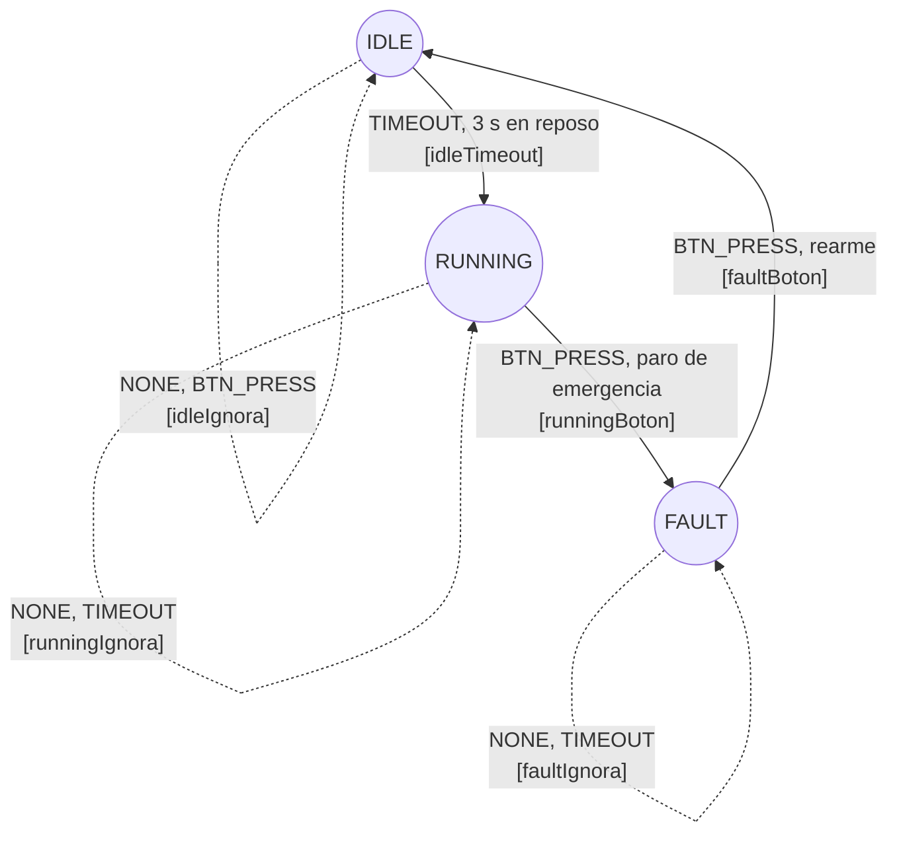

# Arquitectura del firmware

## Diagrama de la máquina de estados

## Matriz de transiciones

Cada celda de la matriz `FSM[estado][evento]` guarda el puntero al handler que se ejecuta. El handler realiza la acción sobre el motor y devuelve el estado siguiente. El despacho es una consulta directa de tiempo constante O(1), sin `if` ni `switch` para la lógica de estados.

| Estado \ Evento | NONE | BTN_PRESS | TIMEOUT |
|---|---|---|---|
| IDLE | idleIgnora, sigue en IDLE | idleIgnora, sigue en IDLE | idleTimeout, pasa a RUNNING |
| RUNNING | runningIgnora, sigue en RUNNING | runningBoton, pasa a FAULT | runningIgnora, sigue en RUNNING |
| FAULT | faultIgnora, sigue en FAULT | faultBoton, pasa a IDLE | faultIgnora, sigue en FAULT |

## Origen de los eventos

- **BTN_PRESS:** el microinterruptor en IO33 dispara una interrupción por flanco de bajada. La ISR filtra el rebote con el registro CCOUNT (al menos 4.000.000 ciclos, 25 ms a 160 MHz) y, dentro de un spinlock, levanta una bandera `volatile` e incrementa el contador de pulsaciones.
- **TIMEOUT:** `leerEvento()` compara `millis()` con el instante en que se entró al estado actual. Solo IDLE tiene límite (3 s); en los demás estados el límite es 0, es decir, no hay timeout. Esto se evalúa en el bucle principal, nunca en la ISR.
- **NONE:** ningún evento pendiente en esa vuelta del bucle.

## Acciones

| Handler | Efecto sobre el motor |
|---|---|
| `idleTimeout` | PWM de avance con ciclo de trabajo 700 de 1024 |
| `runningBoton` | Freno dinámico: ambas entradas del puente H al 100 % |
| `faultBoton` | Giro por inercia: ambas entradas en 0 |
| `idleIgnora`, `runningIgnora`, `faultIgnora` | Sin efecto; devuelven el mismo estado |

## Capas del código

| Capa | Archivos | Responsabilidad |
|---|---|---|
| Aplicación | `src/main.cpp` | Inicialización y bucle sin bloqueos |
| Entrada | `include/boton_isr.h`, `src/boton_isr.cpp` | ISR de IO33 en IRAM, depuración por CCOUNT, spinlock, bandera y contador |
| Control | `include/fsm_control.h`, `src/fsm_control.cpp` | Estados, eventos, matriz `constexpr` de handlers y lectura de eventos |
| Hardware | `include/hal_motor.h`, `src/hal_motor.cpp` | PWM por hardware (LEDC) con avance, freno y giro por inercia |

## Flujo ISR a bucle principal

1. El flanco de bajada en IO33 llama a `isrBoton`, que reside en IRAM.
2. Si pasaron al menos 4.000.000 ciclos desde el último disparo válido, entra al spinlock (`portENTER_CRITICAL_ISR`), levanta la bandera y suma 1 al contador de pulsaciones.
3. En `loop()`, `fsmActualizar` llama a `leerEvento`, que consulta la bandera con `botonTomarEvento` (dentro de un spinlock con `portENTER_CRITICAL`) y evalúa el timeout del estado actual.
4. El evento resultante (BTN_PRESS, TIMEOUT o NONE) se despacha por la matriz y se ejecuta su handler.
5. Ni la ISR ni el bucle usan `delay()`: el bucle consulta eventos y despacha en cada vuelta.
