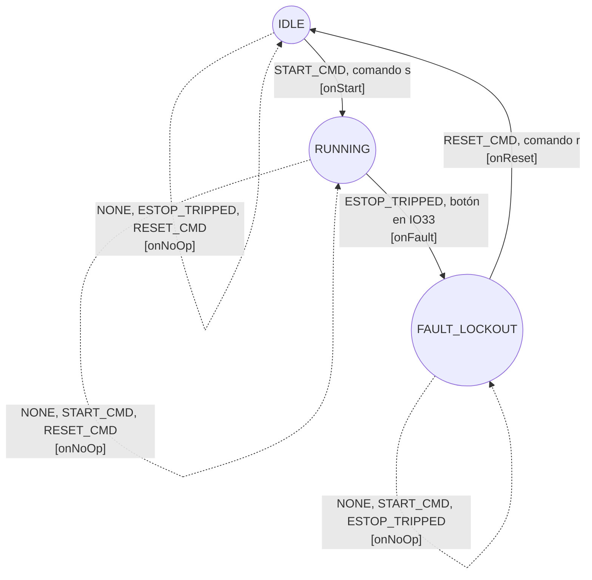

# Arquitectura del firmware

## Diagrama de la máquina de estados

## Matriz de transiciones

Cada celda de `FSM[estado][evento]` guarda el siguiente estado y el puntero a la acción que se ejecuta. La consulta es directa, de tiempo constante O(1), sin `if` ni `switch` para decidir la transición.

| Estado \ Evento | NONE | START_CMD | ESTOP_TRIPPED | RESET_CMD |
|---|---|---|---|---|
| IDLE | IDLE, onNoOp | RUNNING, onStart | IDLE, onNoOp | IDLE, onNoOp |
| RUNNING | RUNNING, onNoOp | RUNNING, onNoOp | FAULT_LOCKOUT, onFault | RUNNING, onNoOp |
| FAULT_LOCKOUT | FAULT_LOCKOUT, onNoOp | FAULT_LOCKOUT, onNoOp | FAULT_LOCKOUT, onNoOp | IDLE, onReset |

FAULT_LOCKOUT es un estado de bloqueo: una vez activado el paro de emergencia, solo el comando de reinicio (`r`) vuelve a IDLE. Un nuevo disparo del botón o un comando de arranque no hacen nada, por eso un rebote del microinterruptor al soltarlo no puede rearmar el sistema.

## Origen de los eventos

- **ESTOP_TRIPPED:** el microinterruptor en IO33 dispara una interrupción por flanco de bajada. La ISR `emergencyStopISR` filtra el rebote con el registro CCOUNT (al menos 4.000.000 ciclos, 25 ms a 160 MHz) y, dentro de un spinlock, levanta `emergencyFlag` y suma 1 a `pressCount`.
- **START_CMD y RESET_CMD:** comandos que se escriben en el monitor serie a 115200 baudios: `s` arranca y `r` reinicia (con mayúscula o minúscula).
- **NONE:** ninguna de las anteriores en esa vuelta del bucle.

`leerEvento()` entrega un solo evento por vuelta, y el paro de emergencia tiene prioridad sobre los comandos.

## Acciones

| Acción | Efecto sobre el motor |
|---|---|
| `onStart` | `motorForward(DUTY_AVANCE)`: avance con PWM de 700 sobre 1024 |
| `onFault` | `motorBrake()`: freno dinámico, ambas entradas del puente H al 100 % |
| `onReset` | `motorCoast()`: suelta el freno, el motor queda libre |
| `onNoOp` | Sin efecto |

Cada acción, salvo `onNoOp`, imprime además un mensaje por el puerto serie.

## Capas del código

| Capa | Archivos | Responsabilidad |
|---|---|---|
| Aplicación | `src/main.cpp` | ISR, lectura de eventos, bucle principal, tarea de telemetría y acciones |
| Control | `include/fsm_core.h`, `src/fsm_core.cpp` | Estados, eventos, tipo `Transition`, matriz `FSM` y nombres para el monitor |
| Hardware | `include/motor_hal.h`, `src/motor_hal.cpp` | PWM por hardware (LEDC) con `motorForward`, `motorBrake` y `motorCoast` |

## Sincronización entre contextos

| Dato o recurso | Quiénes lo comparten | Mecanismo |
|---|---|---|
| `emergencyFlag` y `pressCount` | ISR y `loop()` | Spinlock `isrSpinlock` y `volatile` |
| `lastInterruptCycle` | Solo la ISR | Ninguno, no se comparte |
| Puerto Serial | `loop()` y `telemetryTask` | Mutex `serialMutex` |
| `currentState` | `loop()` lo escribe y `telemetryTask` lo lee | `volatile`: es un byte y la tarea solo lo imprime |

La regla que sigue el diseño: entre una tarea y una ISR se usa un spinlock, porque la ISR no puede bloquearse; entre dos tareas se usa un mutex de FreeRTOS, porque una tarea sí puede esperar.

## Flujo de un paro de emergencia

1. Con el motor en marcha (RUNNING), el operador presiona el microinterruptor y IO33 baja de nivel.
2. El hardware dispara `emergencyStopISR`. La ISR lee CCOUNT, comprueba que pasaron al menos 4.000.000 ciclos desde el último disparo válido y entra al spinlock.
3. Dentro del spinlock levanta `emergencyFlag`, suma 1 a `pressCount` y sale.
4. En la siguiente vuelta, `loop()` llama a `leerEvento()`, que con `takeEmergency()` lee y limpia la bandera dentro del mismo spinlock y devuelve `ESTOP_TRIPPED`.
5. `loop()` consulta `FSM[RUNNING][ESTOP_TRIPPED]`, imprime el estado inicial, el evento y el estado siguiente, actualiza `currentState` a FAULT_LOCKOUT y ejecuta `onFault`, que frena el motor.
6. Si el botón rebota al soltarse y llega otro disparo, en FAULT_LOCKOUT ese evento se ignora y el sistema permanece bloqueado hasta recibir `r`.

## Tarea de telemetría

`telemetryTask` corre en el núcleo 1 con prioridad 1 y cada 500 ms imprime el estado actual, usando `imprimir()`, que toma el mutex del Serial. El bucle `loop()` termina cada vuelta con `vTaskDelay` de 10 ms, que cede el procesador al planificador.
